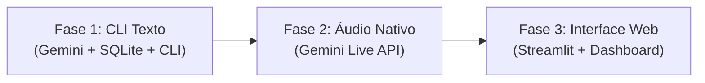
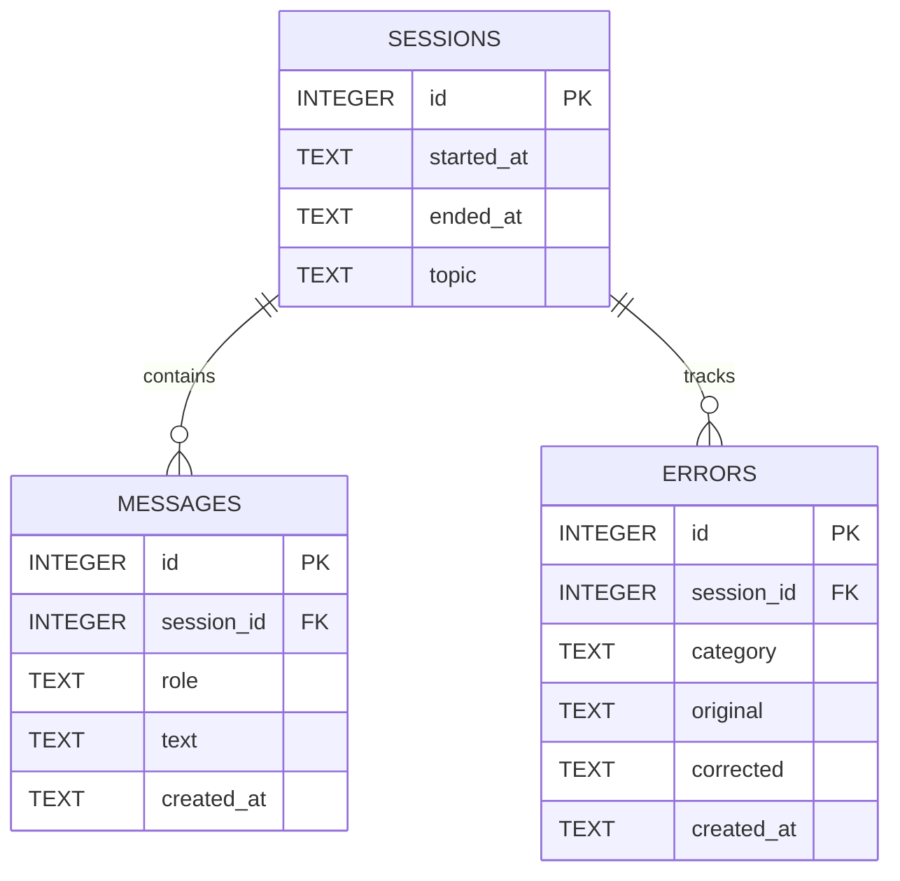

# Plano de Implementação - English Speaking Coach (v3)

## 1. Visão Geral e Estratégia

Este documento orienta o desenvolvimento passo a passo do **English Speaking Coach**, um tutor conversacional inteligente baseado na API do Google Gemini, voltado para estudantes brasileiros de nível A2–B1. O projeto é executado inteiramente na raiz `F:\Agent\`, sem subpastas extras, dividido em três fases evolutivas:



---

## 2. Estrutura de Diretórios do Projeto

```text
F:\Agent\
├── .venv/                         # Ambiente virtual Python (3.11+)
├── .git/                          # Controle de versão Git
├── .gitignore                     # Ignora .venv, .env, data/
├── .env.example                   # Modelo de configuração (GEMINI_API_KEY, GEMINI_MODEL)
├── .env                           # Chave de API local (nunca versionada nem exibida)
├── requirements.txt               # Dependências externas do projeto
├── README.md                      # Documentação de introdução, instalação e execução
├── english-speaking-coach-specification-v1.md # Especificação v1 original (preservada)
│
├── docs/                          # Documentação técnica e pedagógica
│   ├── ESPECIFICACAO.md           # Especificação v3 consolidada (100% em inglês)
│   ├── PLANO.md                   # Este plano de implementação
│   ├── ARQUITETURA.md             # Desenho de arquitetura e fluxo de dados (futuro)
│   ├── PROMPTS.md                 # Versões e calibração dos prompts
│   └── DIARIO.md                  # Diário de bordo atualizado ao fim de cada etapa
│
├── data/                          # Dados locais da aplicação (ignorado no git)
│   └── coach.db                   # Banco de dados relacional SQLite
│
└── src/                           # Código-fonte modular
    ├── __init__.py
    ├── main.py                    # Ponto de entrada do CLI (loop interativo no terminal)
    ├── config.py                  # Leitura segura de .env e caminhos do projeto
    ├── agent/                     # Integração com a API do Google Gemini
    │   ├── __init__.py
    │   ├── coach.py               # Orquestrador do agente e processamento de turnos
    │   └── prompts.py             # System prompt e esquema de resposta estruturada
    └── storage/                   # Camada de banco de dados SQLite
        ├── __init__.py
        ├── database.py            # Inicialização de conexão e criação de tabelas
        └── repository.py          # Operações de CRUD (sessões, mensagens, erros)
```

---

## 3. Requisitos de Ambiente e Stack Técnica

- **Ambiente Python**: Python 3.11 ou superior.
- **Modelo Gemini**:
  - `GEMINI_MODEL`: configurável via `.env` (padrão oficial ativo: `gemini-2.5-flash`).
  - Chamada à API com resiliência a timeouts, retries automáticos e tratamento de erros.
- **Armazenamento**: SQLite nativo (`sqlite3`), arquivo local em `data/coach.db`.
- **Política de Idioma Estrita**: 100% em inglês, sem suporte ou respostas em português sob nenhuma circunstância.
  - Se o aluno escrever em português, o coach compreende a mensagem e responde inteiramente em inglês, indicando como dizer aquilo em inglês (*"You could say: '...'"*).
  - Em erros reincidentes, explica em inglês mais simples com exemplo curto.
- **Privacidade & Segurança**:
  - Arquivo `.env` **nunca deve ser lido, impresso nem commitado**.
  - Pasta `data/` protegida no `.gitignore`.

---

## 4. Arquitetura de Dados (SQLite)

O armazenamento persistente utiliza o banco de dados nativo **SQLite** (`data/coach.db`), operado pelo módulo padrão `sqlite3` do Python.

### 4.1. Esquema Relacional (3 Tabelas)



1. **`sessions`**: Registra as sessões de estudo (`id`, `started_at`, `ended_at`, `topic`).
2. **`messages`**: Armazena o diálogo turno a turno (`student` e `coach`).
3. **`errors`**: Registra cada erro identificado. Categorias fixas e padronizadas:
   - `past_tense`, `present_tense`, `preposition`, `article`, `word_order`, `agreement`, `vocabulary`, `other`.

---

## 5. Dinâmica Pedagógica, Detecção de Reincidência e Sem Limite de Tempo

- **Sem limite artificial de tempo ou de frases**: O coach responde de forma natural e proporcional à fala do aluno, focando em fluidez e clareza.
- **Regra de 1 Erro por Turno**: Corrige no máximo 1 erro principal por interação, priorizando a compreensão da ideia.
- **Tratamento de Reincidência**:
  - O sistema envia no prompt a categoria do erro do turno anterior e os erros mais frequentes do histórico.
  - Se o erro da mesma regra se repetir em turnos consecutivos, o coach explica de outro jeito, em **inglês ainda mais simples e com um exemplo curto**, sem usar português.
- **Saída Estruturada**:
  - `reply`: A resposta conversacional vista pelo aluno (100% em inglês).
  - `error_detected`: Objeto com `category`, `original` e `corrected`. **Preenchido somente quando o `reply` de fato corrigir o erro**; caso contrário, deve ser `null`.

---

## 6. Tratamento Robusto de Erros

1. **Chave de API Ausente**:
   - Validação na inicialização (`src/config.py`).
   - Se `GEMINI_API_KEY` não estiver definida, o programa orienta em português sobre como configurar o `.env` com base no `.env.example` e encerra com código amigável sem lançar stack trace cru.
2. **Falha de Rede e Conectividade**:
   - Tratamento de exceções com retry automático e mensagem clara para tentar novamente sem perder a sessão.
3. **Limite de Taxa / Cota da API (Rate Limit 429)**:
   - Tratamento de `ClientError` (código HTTP 429 / `RESOURCE_EXHAUSTED`), alertando o aluno de forma compreensível.
4. **Encerramento por Teclado (`Ctrl+C` / `KeyboardInterrupt`)**:
   - Captura graciosa de interrupção em qualquer ponto do loop conversacional.
   - Atualização imediata do campo `ended_at` da sessão atual no SQLite antes do encerramento.

---

## 7. Detalhamento das Fases

### Fase 1: CLI em Texto e Persistência SQLite

#### Etapa 1.1: Dependências, Configuração e Ambiente
- Criar `requirements.txt`: `google-genai`, `python-dotenv`, `pydantic`.
- Criar `.env.example`: `GEMINI_API_KEY` e `GEMINI_MODEL=gemini-2.5-flash`.
- Atualizar `.gitignore` protegendo `.env` e `data/`.
- Implementar `src/config.py`: carregamento seguro de variáveis e validação.

#### Etapa 1.2: Camada de Dados SQLite (`src/storage/`)
- Implementar `src/storage/database.py` e `src/storage/repository.py`.
- Suporte a injeção de conexão para testes com banco temporário em memória (`:memory:`).

#### Etapa 1.3: Agente Coach e Prompts (`src/agent/`)
- Implementar `src/agent/prompts.py`:
  - System prompt 100% em inglês estrito.
  - Categorias de erro fixas (`past_tense`, `present_tense`, `preposition`, `article`, `word_order`, `agreement`, `vocabulary`, `other`).
  - Injeção contextual do erro anterior e erros frequentes.
- Implementar `src/agent/coach.py`:
  - Saída estruturada (`reply` + `error_detected`).
  - Hierarquia de exceções (`APIError`, `ClientError`, `ServerError`).
  - Retry automático em resposta vazia ou JSON inválido.

#### Etapa 1.4: Interface CLI (`src/main.py`)
- Loop interativo no terminal:
  - Saudação inicial amigável em inglês simples estimulando a prática.
  - Comandos: `/help`, `/errors`, `/exit`.
  - Captura graciosa de `Ctrl+C` com encerramento de sessão gravando `ended_at`.

#### Etapa 1.5: Testes e Validação Pedagógica
- Testes com banco em memória cobrindo erros em inglês, frases corretas, reincidência e entradas em português.

---

### Fase 2: Integração de Áudio Nativo (Speech-to-Speech)
- Conexão com a **Gemini Live API** (áudio bidirecional em tempo real).
- Captura de microfone e reprodução de áudio contínuo no Windows.
- Sincronização do áudio com a gravação de mensagens e erros no SQLite.

---

### Fase 3: Interface Gráfica (Streamlit)
- Interface web moderna desenvolvida em Streamlit.
- Histórico visual de chat e reprodutor de áudio.
- Painel analítico do aluno alimentado por consultas SQL na tabela `errors`.
- Seleção de tópicos de conversa e metas de estudo.

---

## 8. Critérios de Conclusão da Fase 1

1. Dependências instaladas e `src/config.py` validado.
2. Banco SQLite `data/coach.db` operacional com testes automatizados de CRUD.
3. Chat no terminal funcional, com respostas fluidas 100% em inglês e detecção silenciosa de erros no SQLite.
4. Diário de bordo `docs/DIARIO.md` e `docs/PROMPTS.md` documentados.
